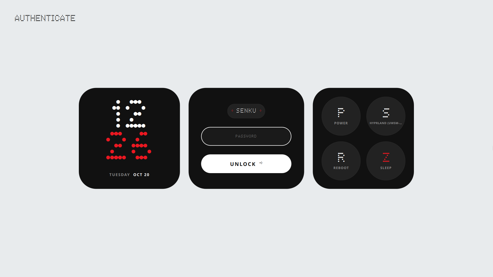
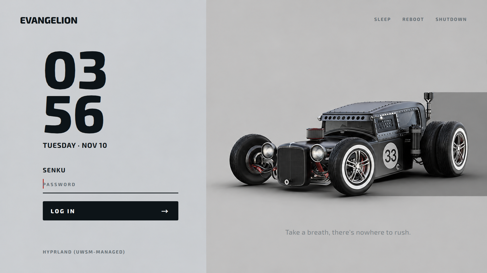
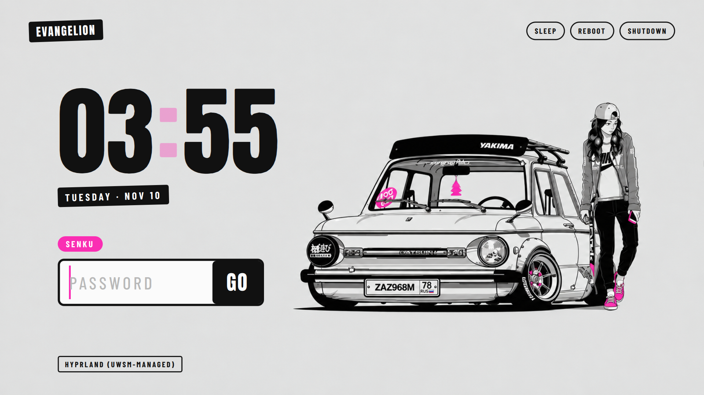

# rd's SDDM Themes

A collection of my minimal, opinionated SDDM login themes.

## Themes

### nothing

> Dot-matrix widget login — inspired by Nothing OS.

A three-panel layout: dot-matrix clock · password login · system actions. Light grey background, dark widget cards, red accents.



### ironclad

> Hot-rod editorial login — heavy Exo 2 type over a studio-grey backdrop.




### pinkslip

> Street-sticker login — poster-weight type, hot-pink accents, and a licence-plate password field.




## Installation

```bash
git clone https://github.com/senku/rd-sddm-themes
cd rd-sddm-themes
./install.sh
```

Run it as your normal user. The script lists the available themes and asks which one to install, then asks for your `sudo` password only when it needs to write to system folders. To skip the menu, pass the theme name: `./install.sh ironclad`.

It will:
1. Copy the chosen theme to `/usr/share/sddm/themes/`
2. Write `/etc/sddm.conf.d/theme.conf` with `Current=<theme>`

Then restart SDDM:

```bash
sudo systemctl restart sddm
```


## Requirements

- SDDM ≥ 0.20
- Qt 6
- Roboto or Inter system font (fallback to sans-serif)


## License

MIT
