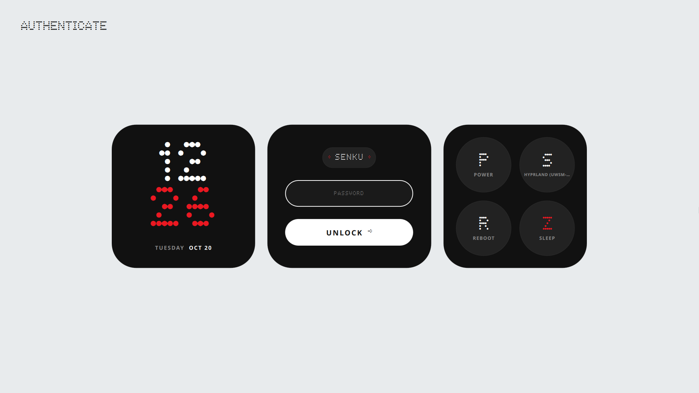

# rd-sddm-themes

A collection of minimal, opinionated SDDM login themes.

---

## Themes

### nothing

> Dot-matrix widget login — inspired by Nothing OS.

A three-panel layout: dot-matrix clock · password login · system actions. Light grey background, dark widget cards, red accents.



**Features**
- NDot55 dot-matrix font for the clock and labels
- Smooth fade-in entrance animation
- Click username pill to cycle users
- Click session button to cycle desktop sessions
- Shake animation on failed login

---

## Installation

```bash
git clone https://github.com/senku/rd-sddm-themes
cd rd-sddm-themes
sudo ./install.sh
```

The script will:
1. Copy the theme to `/usr/share/sddm/themes/`
2. Write `/etc/sddm.conf.d/theme.conf` with `Current=nothing`

Then restart SDDM:

```bash
sudo systemctl restart sddm
```

> [!NOTE]
> The installer defaults to the **nothing** theme. To switch themes, edit the `THEME_NAME` variable at the top of `install.sh` before running it (once more themes are available).

---

## Requirements

- SDDM ≥ 0.20
- Qt 6
- Roboto or Inter system font (fallback to sans-serif)

---

## License

MIT
