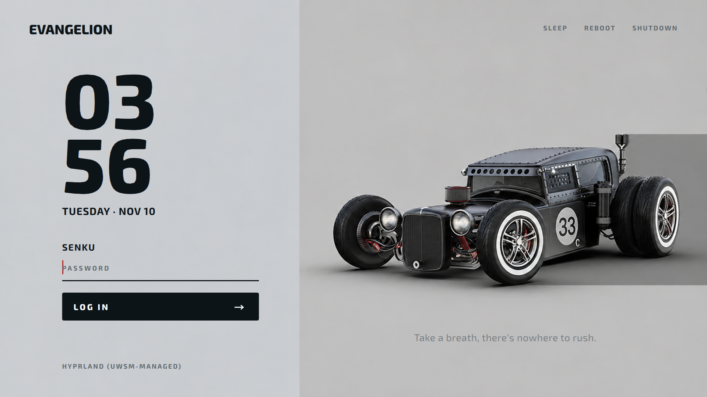
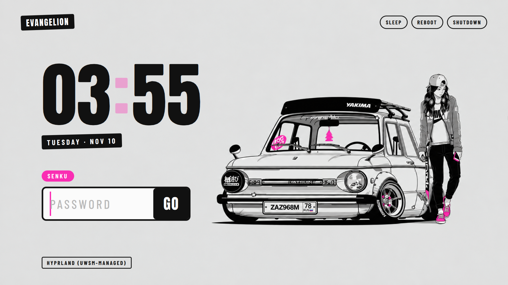
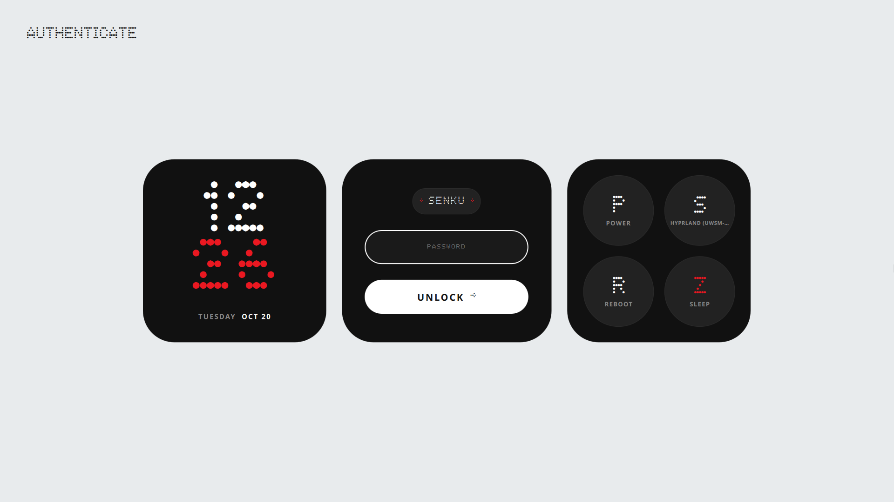
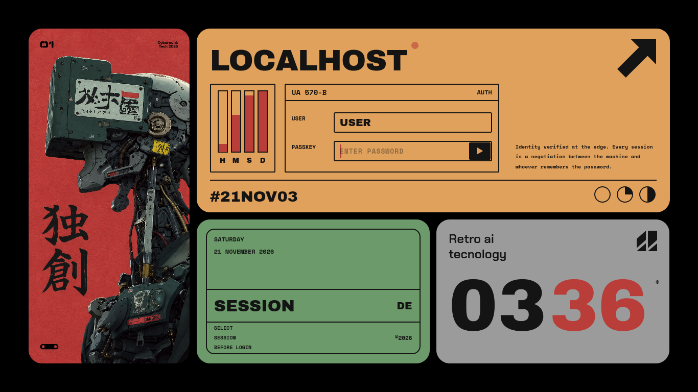

# rd's SDDM Themes

A collection of my minimal, opinionated SDDM login themes.

## Themes


### ironclad

> Hot-rod editorial login — heavy Exo 2 type over a studio-grey backdrop.




### pinkslip

> Street-sticker login — poster-weight type, hot-pink accents, and a licence-plate password field.



### nothing

> Dot-matrix widget login — inspired by Nothing OS.

A three-panel layout: dot-matrix clock · password login · system actions. Light grey background, dark widget cards, red accents.




### CBRPNK

> Bento-card cyberpunk login — robot poster, orange console, flat colour panels.

Black canvas with four rounded cards: the poster, an orange console holding the login (click the user box to switch user, the green card to cycle sessions), and a grey clock. Power actions are the three circles. Bundles Archivo Black, Space Mono and Chakra Petch (all OFL).

Install it with `./install.sh CBRPNK`.




## Installation

```bash
git clone https://github.com/rd6260/sddm-themes.git
cd rd-sddm-themes
./install.sh
```

Run it as your normal user. The script lists the available themes and asks which one to install, then asks for your `sudo` password only when it needs to write to system folders. To skip the menu, pass the theme name (case-sensitive, as the folder is named): `./install.sh ironclad`.

It will:
1. Copy the chosen theme to `/usr/share/sddm/themes/`
2. Write `/etc/sddm.conf.d/theme.conf` with `Current=<theme>`

Then restart SDDM:

```bash
sudo systemctl restart sddm
```


## Requirements

- SDDM ≥ 0.20
- Qt 6
- Roboto or Inter system font (fallback to sans-serif)


## License

MIT
